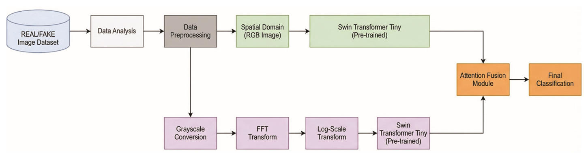
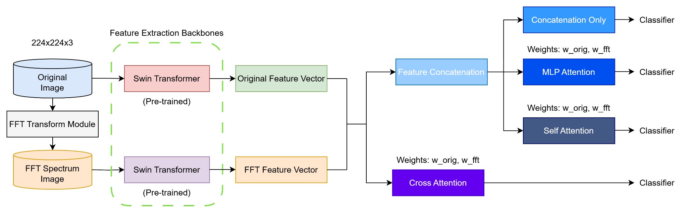
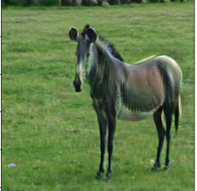
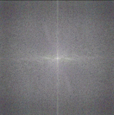
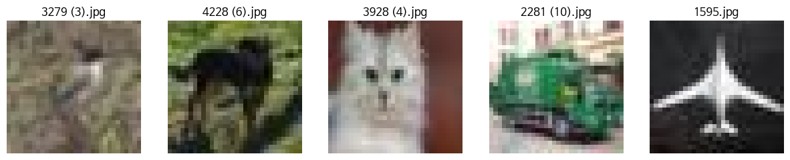
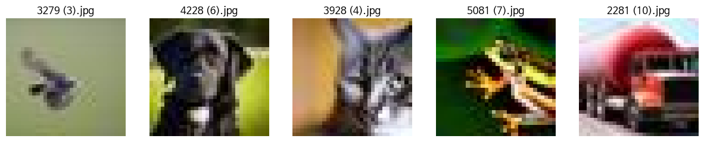
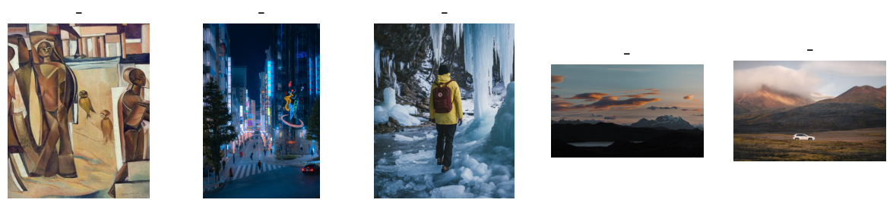
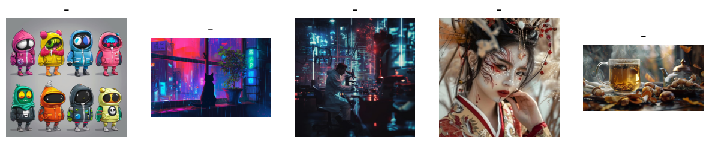
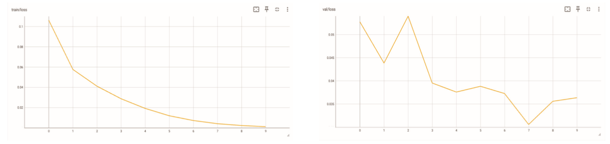
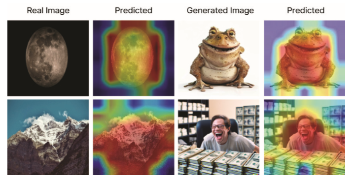

# 생성형 AI 합성 이미지 판별을 위한 Swin Transformer 기반 주파수 정보 통합 전략에 관한 연구
> **A Study on Frequency Integration Strategies with Swin Transformer for AI-generated Image Detection**

[-0052CC?style=flat-square)](#학술지-게재-정보-publication)
[](http://dx.doi.org/10.13067/JKIECS.2026.21.3.1101)
[](#핵심-전처리-및-모델-구조-reference-code)
[](#제안-프레임워크-proposed-framework)
[_%2B_Frequency_(2D_FFT)-FF8C00?style=flat-square)](#2d-fft-주파수-스펙트럼-전처리)
[](#grad-cam-기반-설명-가능성-분석-xai)

---

## 학술지 게재 정보 (Publication)

* **논문명(국문)**: 생성형 AI 합성 이미지 판별을 위한 Swin Transformer 기반 주파수 정보 통합 전략에 관한 연구
* **논문명(영문)**: *A Study on Frequency Integration Strategies with Swin Transformer for AI-generated Image Detection*
* **학술지**: 한국전자통신학회 논문지 (*Journal of the Korea Institute of Electronic Communication Sciences*, **KCI 등재지**), 제21권 제3호, pp. 1101–1108 (2026. 06. 30.)
* **저자**: 김상훈(제1저자) · **김정훈(공동1저자)** · 정원식(교신저자) | 건양대학교 의료인공지능학과 / 인공지능학과
* **DOI**: [`http://dx.doi.org/10.13067/JKIECS.2026.21.3.1101`](http://dx.doi.org/10.13067/JKIECS.2026.21.3.1101)
* **사사(Acknowledgment)**: 본 연구는 2025년도 교육부 및 대전광역시의 재원으로 대전RISE센터의 지원을 받아 수행된 지역혁신중심 대학지원체계(RISE)의 결과물임 (`2025-RISE-06-001`)

---

## 연구 배경 및 요약 (Overview)

Stable Diffusion, MidJourney, DALL-E 등 확산 모델(Diffusion Models)과 GAN 기반 생성 기술이 고도화되면서 사람의 눈으로 진위를 가리기 어려운 합성 이미지가 빠르게 늘고 있습니다. 기존 합성 이미지 탐지 연구는 주로 RGB 픽셀 단위의 공간 도메인(Spatial Domain) 특징을 추출하는 CNN 모델을 사용했으나, 수용 영역(Receptive Field)이 국소적이어서 이미지 전반의 구조적 일관성을 포착하는 데 한계가 있었습니다. 특히 학습에 사용된 단일 생성기에는 높은 정확도를 보이더라도 생성 방식이 다른 다중 생성 모델(MidJourney, DALL-E 등)로 평가 범위를 넓히면 일반화 성능이 급격히 떨어지는 문제가 발생합니다.

생성형 모델은 잠재 공간(Latent Space)에서 고해상도 이미지로 업샘플링(Upsampling)하는 과정에서 공간 도메인에서는 눈에 띄지 않는 미세한 주기적 격자 아티팩트와 고주파 스펙트럼 왜곡을 남깁니다. 본 연구는 이러한 점에 착안하여 **2D 고속 푸리에 변환(2D FFT) 기반 로그 스케일 진폭 스펙트럼**과 **Swin Transformer의 계층적 전역 문맥(Shifted Window Self-Attention)** 특징을 **Attention Fusion Module**로 결합한 듀얼 스트림 판별 프레임워크를 제안합니다.

### 주요 연구 성과 요약
* **단일 생성기 벤치마크(`CIFAKE`, 12만 장)**: `ResNet18`, `MobileNetV3`, `EfficientNet-B0`, `MixNet`, `VGG11`, `DeiT` 등 6종의 비교 모델 대비 가장 높은 **Accuracy `0.987 ± 0.002` / F1-score `0.987 ± 0.002`** 달성
* **다중 생성기 일반화 벤치마크(`Stable Diffusion + MidJourney + DALL-E`, 6만 장)**: 공간 도메인 단일 `Swin-Tiny` 모델(`0.971 ± 0.004`) 대비 Attention 기반 주파수 통합 모델(`Swin-Tiny-FFT w/ attention`)에서 **Accuracy `0.988 ± 0.003` / F1-score `0.988 ± 0.002`**를 기록하며 **+1.7%p 성능 향상 및 분산 감소** 입증
* **Grad-CAM 기반 판별 근거 규명(XAI)**: 모델이 실제 이미지에서는 객체의 형태적 윤곽선과 구조적 영역에 집중하는 반면, 생성형 AI 합성 이미지에서는 국소 텍스처 불일치와 고주파 왜곡 경계에 강하게 반응함을 정성적으로 입증

---

## 연구 발전 과정 (Conference ➔ KCI Journal)

본 프로젝트는 학술대회 발표(`2025. 07`)에서 출발해 전처리 파이프라인 정교화, 다중 생성기 일반화 검증, 설명 가능한 AI(XAI) 분석을 거쳐 KCI 등재 학술지 논문(`2026. 06`)으로 완성되었습니다.

| 구분 | Phase 1: 학술대회 발표 (2025. 07) | Phase 2: KCI 등재지 최종 논문 (2026. 06) |
| :--- | :--- | :--- |
| **주파수 전처리** | RGB 이미지에 기본 2D FFT 스펙트럼 변환 및 정규화 적용 | 흑백(1채널) 변환 후 **위상(Phase) 성분을 배제**하고 **진폭 스펙트럼(Amplitude Spectrum)에 로그 스케일(Log-scale) 변환**을 적용해 저주파·고주파 에너지 불균형 해소 |
| **특징 융합 실험** | `Concat`, `MLP Attention`, `Self-Attention`, `Cross-Attention (Q=RGB / Q=FFT)` 등 5가지 어텐션 결합 구조 탐색 및 하이퍼파라미터(`lr`, `Loss`, `Pre-trained`) 튜닝 | 단일 도메인(`RGB Only`, `FFT Only`) vs 복합 도메인(`Concat`, `Attention Fusion`) 4대 전략 체계화 및 반복 실험 평균·표준편차(`Mean ± Std`) 검증 |
| **판별 근거 해석** | 정량 지표(`Accuracy`, `F1-score`) 중심 성능 비교 | **Grad-CAM** 히트맵 시각화를 도입하여 공간-주파수 통합 모델이 실제 이미지와 합성 이미지에서 주목하는 시각적·주파수적 단서 차이 규명 |

---

## 제안 프레임워크 (Proposed Framework)

### 1. 전체 파이프라인 (KCI Journal Final Architecture)


*▲ 그림 1. 제안하는 Swin Transformer 기반 공간-주파수 정보 통합 판별 프레임워크의 전체 파이프라인*

제안 모델은 입력 이미지를 **공간 도메인 경로(Spatial Stream)**와 **주파수 도메인 경로(Frequency Stream)** 두 갈래로 병렬 처리합니다. 각 경로는 ImageNet-1K로 사전학습된 독립적인 `Swin Transformer Tiny (Swin-Tiny)` 백본을 거쳐 특징 벡터를 추출하며, 후반부 **Attention Fusion Module**에서 두 도메인의 상호보완적 정보를 적응적으로 가중 융합해 최종 진위 여부를 분류합니다.

### 2. 어텐션 기반 특징 융합 세부 구조 (Conference Ablation Architecture)


*▲ 그림 2. 두 개의 Swin Transformer 백본에서 추출된 공간·주파수 특징 벡터 간의 융합 방식 비교 아키텍처*

### 3. 2D FFT 주파수 스펙트럼 전처리

| 공간 도메인 원본 이미지 (Spatial RGB) | 2D FFT 로그 스케일 진폭 스펙트럼 (Frequency Spectrum) |
| :---: | :---: |
|  |  |

주파수 도메인 입력은 다음 5단계를 거쳐 생성됩니다.
1. **흑백 변환(Grayscale Conversion)**: 색상 채널 간 중복을 줄이고 밝기 변화 기반의 주파수 패턴에 집중하기 위해 3채널 RGB 이미지를 1채널 Grayscale로 변환합니다.
2. **2D 고속 푸리에 변환(2D FFT) 및 중심 이동**: 2차원 이산 푸리에 변환을 수행한 뒤 직류(DC, 저주파) 성분이 스펙트럼 중앙에 위치하도록 주파수 영점을 이동(`fftshift`)합니다.
3. **진폭 스펙트럼(Amplitude Spectrum) 추출**: 복소수 주파수 성분 중 합성 이미지 판별에서 유효성이 낮은 위상(Phase) 성분은 제외하고 진폭($|F(u,v)|$) 성분만 계산합니다.
4. **로그 스케일 정규화(Log-Scale Transformation)**: 중앙의 저주파 성분에 에너지가 과도하게 집중되어 고주파 왜곡 패턴이 묻히는 현상을 방지하기 위해 $\log(1 + |F(u,v)|)$ 변환을 적용하여 저주파와 고주파 성분이 균형 있게 반영되도록 정규화합니다.
5. **3채널 복제(Channel Replication)**: 사전학습된 `Swin-Tiny` 백본의 입력 규격(`224×224×3`)에 맞추기 위해 정규화된 1채널 스펙트럼을 3채널로 복제합니다.

---

## 데이터셋 및 실험 설계 (Datasets & Experimental Setup)

단일 생성 모델에서의 기본 판별 성능과 다중 생성 모델에서의 교차 일반화 성능을 입증하기 위해 성격이 상호보완적인 두 가지 대규모 공개 데이터셋(총 **180,000장**)을 사용했습니다.

### 1. 실험 데이터셋 구성

| 구분 | Dataset I: `CIFAKE` | Dataset II: `AI Generated Images vs Real Images` |
| :--- | :--- | :--- |
| **총 이미지 수** | **120,000장** (Real 60,000장 / Fake 60,000장) | **60,000장** (Real 30,000장 / Fake 30,000장) |
| **실제 이미지 (Real)** | `CIFAR-10` 10개 클래스 실제 이미지 | `Unsplash`, `Pexels`, `WikiArt` 수집 고해상도 이미지 |
| **합성 이미지 (Fake)** | **단일 생성 모델**: `Stable Diffusion v1.4` | **다중 생성 모델**: `Stable Diffusion`, `MidJourney`, `DALL-E` |
| **데이터 분할 비율** | Train : Val : Test = `10 : 1 : 1` | Train : Val : Test = `8 : 1 : 1` |
| **원본 해상도 및 포맷** | `32×32` (`JPG` 120,000장) ➔ `224×224` 리사이즈 | 최소 `224×224` ~ 최대 `16384×9832` (`JPG` 49,300장, `PNG` 10,700장) ➔ `224×224` 리사이즈 |
| **검증 목적** | 저해상도 단일 생성 모델에 대한 기본 판별력 및 CNN/ViT 백본 간 공정 비교 | 다양한 생성기와 고해상도 실사·예술 이미지가 혼재된 환경에서의 **일반화(Generalization) 성능** 검증 |

#### 데이터셋 샘플 비교
| `CIFAKE` Real (`CIFAR-10`) | `CIFAKE` Fake (`Stable Diffusion v1.4`) |
| :---: | :---: |
|  |  |
| **`Multi-Generator` Real (`Unsplash` / `Pexels` / `WikiArt`)** | **`Multi-Generator` Fake (`SD` / `MidJourney` / `DALL-E`)** |
|  |  |

### 2. 학습 하이퍼파라미터 및 증강 설정
* **특징 추출 백본**: `Swin Transformer Tiny` (`timm` 라이브러리 `swin_tiny_patch4_window7_224`, ImageNet-1K 사전학습 가중치 초기화)
* **입력 해상도 및 데이터 증강**: `224×224` 리사이즈, 무작위 확대(Random Scale), 좌우 반전(Horizontal Flip), 밝기 및 대비 조절(Brightness & Contrast Jitter), 정규화(Normalization)
* **최적화 설정**: `AdamW` Optimizer (`lr = 5e-5`, `weight_decay = 1e-4`), `CosineAnnealingLR` (`eta_min = 1e-6`)
* **배치 크기 및 에폭**: `Batch Size = 32`, `Epochs = 10` (검증 손실 기준 Early Stopping 적용)
* **손실 함수**: `Binary Cross-Entropy (BCEWithLogitsLoss)`

---

## 실험 결과 (Experimental Results)

### 1. KCI 논문 최종 정량 성능 비교

#### [표 1] `CIFAKE` 데이터셋에서의 비교 모델 및 제안 주파수 통합 전략 성능 비교
> 모든 모델은 동일한 입력 해상도(`224×224`), 데이터 증강, 학습 조건에서 미세 조정(Fine-tuning)한 뒤 반복 실험 평균 및 표준편차(`Mean ± Std`)를 산출했습니다.

| Model | Domain | Accuracy | F1-score | 비고 |
| :--- | :---: | :---: | :---: | :--- |
| `ResNet18` | Spatial (RGB) | `0.973 ± 0.001` | `0.973 ± 0.001` | CNN Baseline |
| `VGG11` | Spatial (RGB) | `0.979 ± 0.002` | `0.979 ± 0.002` | CNN Baseline |
| `MixNet` | Spatial (RGB) | `0.981 ± 0.002` | `0.981 ± 0.002` | Lightweight CNN |
| `EfficientNet-B0` | Spatial (RGB) | `0.982 ± 0.001` | `0.982 ± 0.001` | Lightweight CNN |
| `MobileNetV3` | Spatial (RGB) | `0.985 ± 0.001` | `0.985 ± 0.002` | Lightweight CNN |
| `DeiT` | Spatial (RGB) | `0.984 ± 0.002` | `0.985 ± 0.002` | Vision Transformer |
| `Swin-Tiny` | Spatial (RGB) | `0.987 ± 0.002` | `0.987 ± 0.002` | Shifted Window ViT |
| `Swin-Tiny-FFT (w/ concat)` | Spatial + 2D FFT | `0.987 ± 0.002` | `0.987 ± 0.002` | 단순 특징 결합 |
| **`Swin-Tiny-FFT (w/ attention)`** | **Spatial + 2D FFT** | **`0.987 ± 0.002`** | **`0.987 ± 0.002`** | **제안 모델 (최상위 성능)** |

---

#### [표 2] `AI Generated Images vs Real Images` (다중 생성기) 데이터셋 일반화 성능 비교
> 단일 생성 모델(`CIFAKE`)에서는 공간 도메인만으로도 `0.987`의 포화 성능에 도달했으나, 생성 모델 3종(`Stable Diffusion`, `MidJourney`, `DALL-E`)이 혼합된 다중 생성기 환경에서는 주파수 정보 통합과 Attention 융합의 효과가 뚜렷하게 나타났습니다.

| Model | Domain | Fusion Strategy | Accuracy | F1-score | 단일 RGB 대비 향상폭 |
| :--- | :---: | :---: | :---: | :---: | :---: |
| `Swin-Tiny` | Spatial (RGB Only) | - | `0.971 ± 0.004` | `0.971 ± 0.004` | Baseline |
| `Swin-Tiny-FFT (w/ concat)` | Spatial + 2D FFT | Feature Concatenation | `0.985 ± 0.008` | `0.985 ± 0.008` | `+1.4%p` |
| **`Swin-Tiny-FFT (w/ attention)`** | **Spatial + 2D FFT** | **Attention Fusion** | **`0.988 ± 0.003`** | **`0.988 ± 0.002`** | **`+1.7%p` (분산 최소)** |

* **핵심 분석**: 단순 특징 결합(`w/ concat`)은 정확도를 `0.985`로 끌어올렸으나 표준편차가 `±0.008`로 커지며 생성기별 편차가 발생했습니다. 반면 **Attention Fusion(`w/ attention`)**은 이미지마다 유효한 도메인 특징에 동적 가중치를 부여하여 **정확도와 F1-score를 모두 `0.988`로 높이는 동시에 표준편차를 `±0.002~0.003`으로 줄여 가장 안정적인 일반화 성능**을 달성했습니다.

#### 학습 및 검증 손실 수렴 곡선 (`CIFAKE`)

*▲ 그림 3. CIFAKE 데이터셋에서의 제안 모델(`Swin-Tiny w/ attention`) 학습(좌) 및 검증(우) 손실 곡선. 학습 초반 손실이 빠르게 감소한 뒤 과적합 징후 없이 완만하게 수렴함을 확인했습니다.*

---

### 2. 학술대회 세부 탐색 실험 (Ablation Studies)

KCI 논문 최종 모델 선정에 앞서 학술대회 발표 단계에서 수행한 하이퍼파라미터 민감도 분석 및 5종 어텐션 결합 구조 비교 결과입니다.

#### ① 사전학습(Pre-training), 학습률(LR), 손실 함수에 따른 성능 변화 (`CIFAKE`)

| Model | Pre-trained | Learning Rate | Loss Function | Train Acc | Val Acc | Test Acc | F1-score |
| :--- | :---: | :---: | :---: | :---: | :---: | :---: | :---: |
| `Swin-Tiny` | `False` | `3e-4` | `CrossEntropy` | `0.6613` | `0.6401` | `0.6406` | `0.6241` |
| `Swin-Tiny (FFT Only)` | `False` | `3e-4` | `BCEWithLogitsLoss` | `0.9274` | `0.9087` | `0.9031` | `0.9051` |
| `Swin-Tiny` | `False` | `5e-5` | `BCEWithLogitsLoss` | `0.9741` | `0.9640` | `0.9636` | `0.9635` |
| `Swin-Tiny` | `False` | `1e-5` | `BCEWithLogitsLoss` | `0.9828` | `0.9671` | `0.9643` | `0.9640` |
| `Swin-Tiny` | `True` | `3e-4` | `CrossEntropy` | `0.9739` | `0.9739` | `0.9687` | `0.9669` |
| **`Swin-Tiny`** | **`True`** | **`5e-5`** | **`BCEWithLogitsLoss`** | **`0.9974`** | **`0.9879`** | **`0.9901`** | **`0.9901`** |

#### ② 어텐션 융합 방식 5종 세부 비교 (`CIFAKE` vs `Multi-Generator`)

| Fusion Architecture | Query / Weighting 방식 | `CIFAKE` Test Acc | `CIFAKE` F1 | `Multi-Gen` Test Acc | `Multi-Gen` F1 |
| :--- | :--- | :---: | :---: | :---: | :---: |
| `Swin-Tiny (RGB Only)` | 단일 공간 도메인 | `0.9901` | `0.9901` | `0.9840` | `0.9840` |
| `Swin-Tiny (FFT Only)` | 단일 주파수 도메인 | `0.9181` | `0.9152` | `0.8597` | `0.8705` |
| `Swin-Tiny + FFT (Concat)` | 특징 벡터 단순 연결 | `0.9861` | `0.9861` | `0.9923` | `0.9923` |
| **`Swin-Tiny + FFT + MLP Attention`** | **MLP 게이팅 가중 결합 (`w_orig`, `w_fft`)** | **`0.9912`** | **`0.9912`** | `0.9890` | `0.9890` |
| **`Swin-Tiny + FFT + Self-Attention`** | **모달리티 토큰 간 자기 어텐션** | `0.9902` | `0.9902` | **`0.9925`** | **`0.9925`** |
| **`Swin-Tiny + FFT + Cross-Attention 1`** | **`Query(Q) = RGB`, `Key/Value = FFT`** | `0.9876` | `0.9876` | **`0.9925`** | **`0.9925`** |
| `Swin-Tiny + FFT + Cross-Attention 2` | `Query(Q) = FFT`, `Key/Value = RGB` | `0.9860` | `0.9860` | `0.9722` | `0.9726` |

* **관찰 결과**: Cross-Attention 적용 시 주파수 특징(`FFT`)을 Query로 삼으면(`Cross-Attention 2`) 공간적 구조 정보가 손실되어 성능이 하락(`0.9722`)하는 반면, **원본 공간 특징(`RGB`)을 Query로 두고 주파수 스펙트럼에서 보조 단서를 조회(`Cross-Attention 1`)**하거나 **Self-Attention / MLP Attention**으로 양쪽 도메인을 가중 결합할 때 가장 높은 판별 성능을 보였습니다.

---

## Grad-CAM 기반 설명 가능성 분석 (XAI)

정량 실험에서 최종 선정된 `Swin-Tiny w/ attention` 모델이 실제 이미지와 합성 이미지를 구분할 때 어떤 시각적·주파수적 단서에 주목하는지 확인하기 위해 `Swin Transformer`의 마지막 Stage 특징 맵을 추출하여 입력 이미지 해상도로 보간(Interpolation)한 **Grad-CAM 히트맵**을 분석했습니다.


*▲ 그림 4. CIFAKE 및 AI 생성 이미지 데이터셋에 대한 제안 모델(`Swin-Tiny w/ attention`)의 Grad-CAM 시각화 결과 (좌: 실제 이미지 및 예측 히트맵 / 우: 생성형 AI 합성 이미지 및 예측 히트맵)*

1. **실제 이미지(Real Image, 좌측 달·설산 이미지)**:
   * 모델의 활성화 응답이 객체의 형태적 특징이 뚜렷한 **윤곽선(Contour)**과 의미론적으로 일관된 중심 구조 영역에 집중됩니다.
2. **생성형 AI 합성 이미지(Generated Image, 우측 개구리·인물 이미지)**:
   * 객체의 전체적인 형태보다는 **국소적인 텍스처 불일치가 나타나는 지점, 물리적으로 부자연스러운 피사체-배경 경계 영역, 그리고 고주파 스펙트럼 왜곡이 밀집된 영역(지폐 다발의 반복 패턴, 피부·표면 질감 경계)**에 강한 활성화 응답이 나타납니다.
   * 이는 제안한 공간-주파수 Attention 통합 전략이 단순한 배경 통계가 아니라, 사람의 눈으로 식별하기 어려운 **합성 모델 특유의 비자연적 고주파 결함 패턴을 핵심 판별 단서로 포착**하고 있음을 보여줍니다.

---

## 핵심 전처리 및 모델 구조 (Reference Code)

논문 제3장(3.2 주파수 정보 추출 및 3.3 주파수 정보 통합 전략)의 **2D FFT 로그 스케일 진폭 스펙트럼 변환** 및 **Dual Swin-Tiny Attention Fusion** 핵심 구현 코드입니다.

```python
import torch
import torch.nn as nn
import timm


def extract_log_fft_spectrum(rgb_tensor: torch.Tensor, eps: float = 1e-8) -> torch.Tensor:
    """
    [논문 3.2절] 2D FFT 기반 Log-Scaled Amplitude Spectrum 추출 파이프라인
    1. RGB(3채널) -> Grayscale(1채널) 변환
    2. 2D FFT 적용 및 저주파 중심 이동(fftshift)
    3. 위상(Phase) 성분을 제외한 진폭 스펙트럼(Amplitude Spectrum) 계산
    4. 저주파·고주파 균형을 위한 로그 스케일(Log-scale) 변환 및 정규화
    5. Swin-Tiny 입력 호환을 위한 3채널 복제
    """
    weights = torch.tensor([0.2989, 0.5870, 0.1140], device=rgb_tensor.device, dtype=rgb_tensor.dtype)
    gray = (rgb_tensor * weights.view(1, 3, 1, 1)).sum(dim=1, keepdim=True)

    fft_complex = torch.fft.fft2(gray, dim=(-2, -1))
    fft_shifted = torch.fft.fftshift(fft_complex, dim=(-2, -1))

    amplitude = torch.abs(fft_shifted)
    log_spectrum = torch.log1p(amplitude + eps)

    b = log_spectrum.shape[0]
    flat = log_spectrum.view(b, -1)
    min_val = flat.min(dim=1, keepdim=True)[0].view(b, 1, 1, 1)
    max_val = flat.max(dim=1, keepdim=True)[0].view(b, 1, 1, 1)
    normalized = (log_spectrum - min_val) / (max_val - min_val + eps)

    return normalized.repeat(1, 3, 1, 1)


class DualSwinFFTDetector(nn.Module):
    """
    [논문 3.3절] 공간(RGB) 및 주파수(2D FFT) 특징 통합 Swin-Tiny 판별 모델
    """
    def __init__(self, backbone_name: str = "swin_tiny_patch4_window7_224", pretrained: bool = True):
        super().__init__()
        self.rgb_backbone = timm.create_model(backbone_name, pretrained=pretrained, num_classes=0)
        self.fft_backbone = timm.create_model(backbone_name, pretrained=pretrained, num_classes=0)
        dim = self.rgb_backbone.num_features  # 768

        self.attention_gate = nn.Sequential(
            nn.Linear(dim * 2, dim // 2),
            nn.GELU(),
            nn.Linear(dim // 2, 2),
            nn.Softmax(dim=-1),
        )
        self.classifier = nn.Linear(dim * 2, 1)

    def forward(self, rgb_img: torch.Tensor) -> torch.Tensor:
        fft_img = extract_log_fft_spectrum(rgb_img)
        feat_rgb = self.rgb_backbone(rgb_img)
        feat_fft = self.fft_backbone(fft_img)

        weights = self.attention_gate(torch.cat([feat_rgb, feat_fft], dim=-1))
        fused = torch.cat([feat_rgb * weights[:, 0:1], feat_fft * weights[:, 1:2]], dim=-1)
        return self.classifier(fused)
```

---

## 인용 (Citation)

```bibtex
@article{kim2026swinfft,
  title={생성형 AI 합성 이미지 판별을 위한 Swin Transformer 기반 주파수 정보 통합 전략에 관한 연구 (A Study on Frequency Integration Strategies with Swin Transformer for AI-generated Image Detection)},
  author={Kim, Sang-Hun and Kim, Jeong-Hoon and Jung, Won-sik},
  journal={Journal of the Korea Institute of Electronic Communication Sciences (한국전자통신학회 논문지)},
  volume={21},
  number={3},
  pages={1101--1108},
  year={2026},
  month={jun},
  publisher={The Korea Institute of Electronic Communication Sciences},
  doi={10.13067/JKIECS.2026.21.3.1101}
}
```
